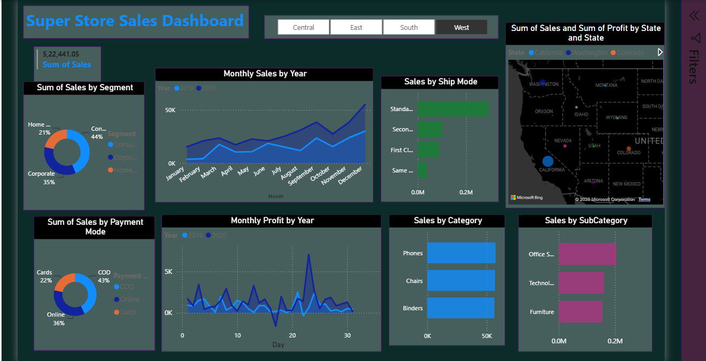
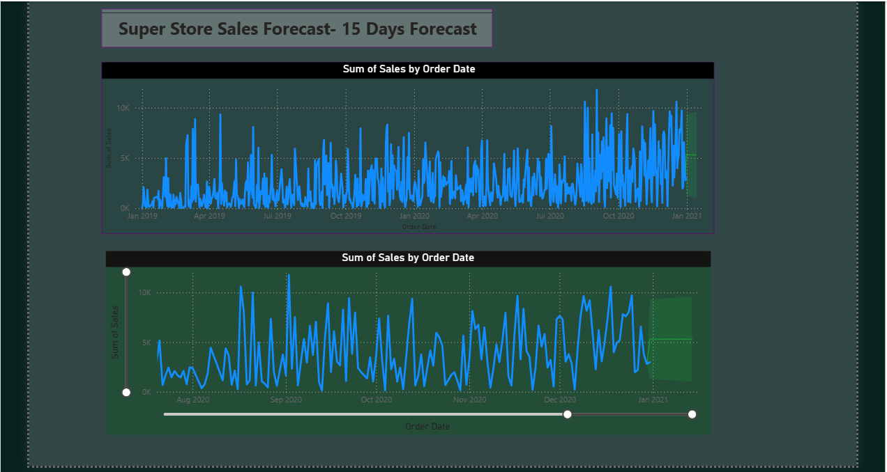

# 📊 Super Store Sales Dashboard (Power BI)


An interactive **Power BI dashboard** analyzing Superstore sales, profit trends across regions, and a **15-day sales forecast**.

## 🎯 Key Features
- Region slicer (Central / East / South / West) filters the whole report
- Sales & profit trends, 2019 vs 2020
- Segment, category, sub-category, ship-mode and payment-mode breakdowns
- Interactive US state map (sales & profit)
- 15-day forecast with date-range slider

## 🖥️ Screenshots
| Sales Overview | Sales Forecast |
|---|---|
|  |  |

## 📈 Dashboard Pages
**1. Sales Overview** – KPI card, segment donut, monthly sales/profit by year, ship mode, payment mode, category & sub-category bars, state map.
**2. Sales Forecast** – Sales by order date (Jan 2019 – Jan 2021) with a 15-day forecast band.

## 🚀 How to Use
1. Clone or download this repo
2. Open `sales.pbix` in [Power BI Desktop](https://powerbi.microsoft.com/desktop/) (free)
3. If prompted, refresh the data (source: `data/superstore_sales_data.csv`)

## 📂 Project Structure
```
├── sales.pbix                      # Power BI report
├── data/superstore_sales_data.csv  # Dataset (~5,897 rows, 27 columns)
├── screenshots/                    # Dashboard previews
├── README.md
├── LICENSE
└── .gitignore
```

## 🛠️ Tools
Power BI Desktop · DAX · Data Modeling · Forecasting

## 📄 License
MIT – see [LICENSE](LICENSE).
